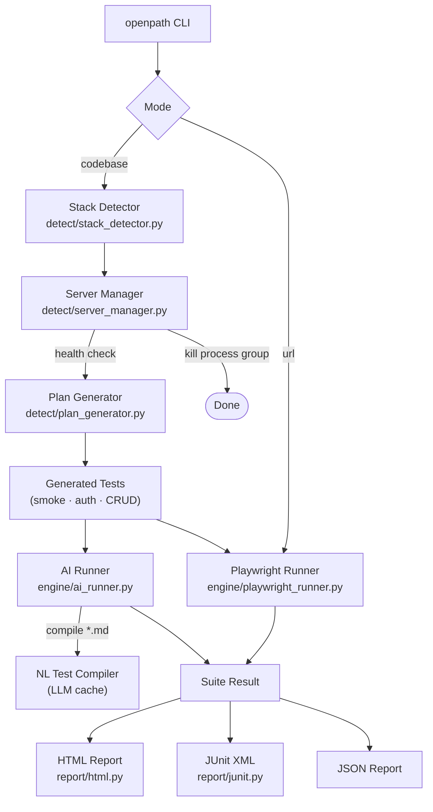

# OpenPath

> **AI-native test automation framework** — the open-source alternative to UiPath for web apps.

Replace drag-and-drop RPA with natural-language test cases. OpenPath detects your stack, boots your app, writes and runs a test plan, and produces a rich HTML report — all from one command.

---

## Architecture



---

## Quickstart

### 1. Install

```bash
git clone https://github.com/your-org/openpath
cd openpath
pip install -e .
playwright install chromium
```

### 2. Configure

```bash
cp .env.example .env
# edit .env — set LLM_API_KEY, TEST_USERNAME, TEST_PASSWORD, etc.
```

### 3. Run against a local repo (codebase mode)

```bash
openpath run --mode codebase --path /path/to/your/app
```

OpenPath will:
1. Detect the stack (Flask / FastAPI / Vite / Next.js / …)
2. Install deps and start the dev server on a free port
3. Generate ≥ 5 tests (smoke + auth + CRUD)
4. Run the suite and kill the server
5. Write `testruns/<run-id>/report.html`

### 4. Run against a live URL (url mode)

```bash
openpath run --mode url --url https://staging.example.com
```

### 5. Record a natural-language test

```bash
openpath record --url http://localhost:5173
# interact in the headed browser, then close the window
# → tests/recorded-<timestamp>.md is created
```

### 6. Run natural-language `.md` tests

```bash
openpath run --mode url --url http://localhost:5173 --ai-tests examples/
```

### 7. Open the last report

```bash
openpath report --open
```

---

## Environment variables (`.env`)

| Variable | Description |
|---|---|
| `BASE_URL` | Default target URL |
| `TEST_USERNAME` | Login username |
| `TEST_PASSWORD` | Login password |
| `LOGIN_SELECTOR_USER` | CSS selector for username field |
| `LOGIN_SELECTOR_PASS` | CSS selector for password field |
| `LOGIN_SELECTOR_SUBMIT` | CSS selector for submit button |
| `LLM_BASE_URL` | OpenAI-compatible API base URL |
| `LLM_API_KEY` | API key (never logged) |
| `LLM_MODEL` | Model name (e.g. `gpt-4o`, `meta/llama-3.1-8b-instruct`) |
| `LLM_MAX_STEPS` | Max AI loop turns per NL step (default 8) |
| `LLM_TIMEOUT` | LLM HTTP timeout in seconds (default 30) |

Works with **OpenAI**, **NVIDIA NIM**, **OpenRouter**, **vLLM**, **Ollama** (with OpenAI-shim).

---

## Natural-language test format (`examples/*.md`)

```markdown
# Login and verify dashboard

- Navigate to the home page
- Log in as the test user
- Assert the heading "Welcome" is visible
- Navigate to /settings
- Select "dark" from the theme dropdown
- Click Save Settings
- Assert the text "Settings saved!" is visible
```

The compiler converts each bullet into a structured action via the LLM and caches the result (keyed by file SHA-256) so subsequent runs are instant.

---

## Self-healing selectors

Tried in order, first match wins:

1. `[data-testid=…]`
2. ARIA role + accessible name (`role=button[name="Login"]`)
3. Visible text (`text=Submit`)
4. CSS selector
5. AI vision coordinates (AI runner fallback)

---

## Assertions

| Type | Description |
|---|---|
| `status_ok` | Page title/URL does not indicate an HTTP error |
| `text_visible` | Given text is visible on page |
| `text_hidden` | Given text is not visible |
| `url_contains` | Current URL contains the given fragment |
| `no_console_errors` | No `[error]` or `[warn]` console messages |
| `no_4xx_5xx` | No failed network responses (ignores favicon/robots) |
| `logged_in` | Current URL is not a login page |
| `element_state` | Element is visible/hidden/enabled/disabled |

---

## Project layout

```
openpath/
├── pyproject.toml              # console_scripts: openpath
├── .env.example
├── .gitignore
├── README.md
├── src/openpath/
│   ├── cli.py                  # CLI entry point
│   ├── config.py               # Pydantic settings
│   ├── env.py                  # .env loading + secret helpers
│   ├── logging.py              # structlog + redaction hook
│   ├── retry.py                # exponential-backoff decorator
│   ├── runner.py               # top-level pipeline orchestrator
│   ├── detect/
│   │   ├── stack_detector.py   # language/framework detection
│   │   ├── server_manager.py   # subprocess lifecycle + health check
│   │   └── plan_generator.py   # automatic test-plan derivation
│   ├── engine/
│   │   ├── playwright_runner.py # deterministic sync runner
│   │   ├── ai_runner.py         # LLM computer-use loop + NL compiler
│   │   ├── selectors.py         # self-healing selector resolution
│   │   ├── assertions.py        # assertion primitives
│   │   └── recorder.py          # headed recording session
│   └── report/
│       ├── html.py              # self-contained HTML report
│       └── junit.py             # JUnit XML + JSON writers
├── tests/
│   ├── test_openpath.py         # 41 unit tests (no browser, no LLM)
│   ├── run_url_mode.py          # URL-mode acceptance helper
│   └── fixtures/demo_app/       # bundled Flask demo app
└── examples/                    # sample *.md natural-language tests
```

---

## Development

```bash
pip install -e ".[dev]"
playwright install chromium

# Unit tests (no browser, no LLM needed):
pytest

# Full acceptance test — codebase mode:
openpath run --mode codebase --path tests/fixtures/demo_app --no-ai

# Full acceptance test — url mode (starts demo app internally):
python tests/run_url_mode.py
```

---

## CI (GitHub Actions example)

```yaml
- uses: actions/setup-python@v5
  with: { python-version: "3.11" }
- run: pip install -e ".[dev]" && playwright install --with-deps chromium
- run: pytest
- run: openpath run --mode codebase --path tests/fixtures/demo_app --no-ai
```

Exit code is `0` on all-pass, `1` on any failure — drop-in for any CI system.

---

## License

MIT
